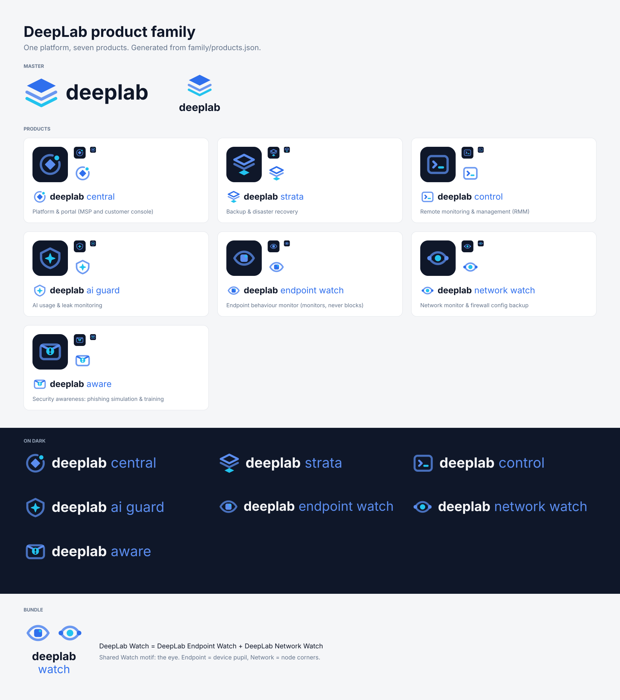

# DeepLab brand guide: "Signal"

Chosen 2026-10-31. Calm, technical, dependable: navy and blue, one cyan highlight.

## Name
- In text: **DeepLab** (capital D, capital L).
- Products: one family on one platform, always written **DeepLab &lt;Product&gt;**: DeepLab Central, DeepLab Strata, DeepLab Control, DeepLab AI Guard, DeepLab Endpoint Watch, DeepLab Network Watch, DeepLab Aware. See [Product family](#product-family).
- In the logo: lowercase **deeplab** wordmark.
- Domain for services: `deeplab.work`.

## Logo
The mark is three stacked layers (depth, layered backups): a solid diamond and two chevrons; the bottom one is cyan.

| File | Use |
|---|---|
| `logo/deeplab-logo.svg` | Mark + wordmark, on white or light backgrounds |
| `logo/deeplab-logo-dark.svg` | Mark + wordmark, on Ink or dark backgrounds |
| `logo/deeplab-mark.svg` / `deeplab-mark-dark.svg` | Mark alone (avatars, app icons, small spaces) |
| `logo/favicon.svg`, `favicon-32.png`, `favicon-192.png` | Browser tab icon (mark on an Ink rounded square) |
| `logo/app-icon-512.png`, `apple-touch-icon.png` | App / home-screen icon (full Ink square, the OS rounds the corners) |
| `logo/deeplab-logo.png`, `deeplab-logo-dark.png` | PNG versions of the full logo (904×256, transparent) for apps that don't take SVG |
| `logo/deeplab-mark-512.png`, `deeplab-mark-dark-512.png` | PNG mark (transparent) |
| `logo/deeplab-logo-stacked.svg` / `-dark.svg` (+ `.png`) | Stacked logo (mark above wordmark) for square spaces |

The master mark belongs to the company. No product uses it as its own icon (see [Product family](#product-family)).

Rules:
- Keep clear space around the logo of at least the height of one chevron.
- Don't recolor, stretch, rotate or add effects. Use the dark version on dark backgrounds instead.
- Minimum size: mark 16 px, full logo 96 px wide.
- The wordmark is outlined Inter Bold (no font needed to display it).

## Colors
| Name | Hex | Use |
|---|---|---|
| Ink | `#0F1729` | Dark surfaces, sidebars, headings on light |
| Signal | `#2F6FED` | Primary: buttons, links, brand moments |
| Signal hover | `#2559C4` | Hover / pressed |
| Signal light | `#5B8DEF` | Brand blue on dark backgrounds |
| Accent | `#22C3EE` | Highlights on dark only. Never as text on white |
| Paper | `#F5F6F8` | Light page background |
| Muted text | `#64748B` | Secondary text |
| Border | `#E2E5EA` | Lines, dividers |
| Success / Warning / Danger | `#15803D` / `#B45309` / `#DC2626` | Status only |

Contrast (WCAG): white on Signal 4.55:1 (AA), white on Signal hover 6.35:1, Ink on white 17.9:1, Accent on Ink 8.6:1, Accent on white **2.1:1 (don't)**.

Rough ratio: 60% Paper/white, 30% Ink, 10% Signal, with Accent as a small spark.

## Type
- **Inter**: headings (Bold 700, slight negative tracking) and body (Regular 400, Medium 500 for UI labels).
- **JetBrains Mono**: code, IDs, hostnames, log output.
- Both are free (SIL Open Font License, Google Fonts).

## Voice
Plain, precise, reassuring. Say what happened and what to do next. No hype.
Example: "Backup finished. 3 files skipped, see details." Not: "Awesome! Your data is supercharged!"

## Product family
Decided 2026-11-13. DeepLab is one platform with seven products (DeepLab Aware added 2026-11-14). Overview: [`family/family-overview.png`](family/family-overview.png). Construction: [`family/family-system.png`](family/family-system.png).

### Architecture
Endorsed brands: **DeepLab** is the endorser on every product; the product name is a descriptor, never a standalone brand.

| Product | Folder | What it is | Mark motif |
|---|---|---|---|
| DeepLab Central | `products/central/` | Platform and portal: the MSP and customer console | Hub: platform core in a ring, one product in orbit |
| DeepLab Strata | `products/strata/` | Backup and disaster recovery | Layers converging on one solid restore point |
| DeepLab Control | `products/control/` | Remote monitoring and management (RMM) | Console with a prompt and a live cursor |
| DeepLab AI Guard | `products/ai-guard/` | AI usage and leak monitoring | Shield (top on the 2:1 layer slope) around one AI spark |
| DeepLab Endpoint Watch | `products/endpoint-watch/` | Endpoint behaviour monitor; monitors, never blocks | Watch eye, pupil = a device |
| DeepLab Network Watch | `products/network-watch/` | Network monitor and firewall config backup | Watch eye, corners = network nodes, pupil = the flow |
| DeepLab Aware | `products/aware/` | Security awareness: phishing simulation and training | Envelope (flap on the 2:1 layer slope) closed by one cyan alert seal with a knocked-out "!": a suspicious e-mail, spotted |
| DeepLab Watch (bundle) | `products/watch/` | Endpoint Watch + Network Watch sold together | No own mark: both Watch marks side by side |

### Naming rules
- Public text always uses the full name: **DeepLab Central**, **DeepLab Strata**, **DeepLab Control**, **DeepLab AI Guard**, **DeepLab Endpoint Watch**, **DeepLab Network Watch**, **DeepLab Aware**.
- After the first mention in long text, the short form (Strata, Control, AI Guard, Aware) is fine. For the Watch pair, keep the full "DeepLab Endpoint Watch" / "DeepLab Network Watch" in public text. The short "Endpoint Watch" / "Network Watch" is only for the portal navigation.
- Never "NetWatch", "EWatch", "DL Watch", "DeepLab-Strata" (hyphen), "Deeplab" or "DEEPLAB" in text.
- "DeepLab Watch" names the bundle only, never one of the two products.
- In logos the wordmark is lowercase (`deeplab strata`, `deeplab ai guard`); in text, product names use title case as above.
- Internal identifiers stay unchanged: binaries, services, packages, repos, config keys, API paths (`dlbkp-*`, `aiguard`, etc.). Renaming them needs its own migration plan; brand names only change what a user reads.
- The single source for names is [`family/products.json`](family/products.json). To rename a product, edit it, run `family/build.py` and commit. Every lockup, icon and sheet is rebuilt from that table.

### Wording (Watch products)
DeepLab Endpoint Watch and DeepLab Network Watch **monitor, detect and alert**. Never write that they "protect", "prevent" or "block", and never call them "EDR" or "firewall protection". Network Watch *backs up* firewall configuration; it is not a firewall.

### Construction rules (every product mark)
| Rule | Value |
|---|---|
| Grid | 64 × 64 units; template: [`family/template-mark.svg`](family/template-mark.svg) |
| Live area | 6–58. Nothing, stroke included, leaves it |
| Stroke | 5.5 units, round caps and joins. Stroke centres sit on the 8.75 keylines (square or circle r 23.25) |
| Angles | 0°, 45°, 90°, or the master mark's 2:1 layer slope (26.57°). Curves only for eyes, rings, the shield bottom and round solids (dots, nodes, the Aware seal). The AI spark is the one free-form shape |
| Corners | Rounded rectangles r 8 (frames); small solids r 4–4.5 |
| Colour roles | **Core** Signal 100 % (solid forms). **Support** Signal at 70 % (75 % on dark) for containers and secondary strokes. **Spark** Accent cyan for exactly **one** element: what the product protects or watches |
| On dark | Core becomes Signal light `#5B8DEF`; cyan unchanged |
| Never | Gradients, shadows, outlines around marks, text in marks, more than one cyan element |

### Lockups
- **Horizontal:** product mark (64) → 12 units → `deeplab` in Inter Bold 38 (Ink, or Paper on dark) → one word space (10.7) → product name in Inter Regular 38 (Signal, or Signal light on dark). Baseline 44. All outlined.
- **Stacked:** mark at 1.5× on top, then `deeplab` and the product name on two centred lines.
- **Bundle:** both member marks side by side (8 units apart), then `deeplab watch`.
- Clear space: 11.5 units (one layer step of the master mark) on every side. Minimum size: mark 16 px; lockups 24 px tall (below that, use the icon alone).

### Icons and favicons
- `<id>-icon.svg`: dark mark on an Ink tile, radius 14/64, glyph at 75 %. Use it as the SVG favicon.
- `<id>-icon-16.png` uses a bigger glyph (87.5 %) so it stays legible; `-32.png` is the normal tile. Both have transparent corners.
- `<id>-icon-180.png` (Apple touch) and `-512.png` (app, installer) are full Ink squares; the OS rounds the corners.
- There is no light-tile variant. On light UI use the transparent `<id>-mark.svg`.

### Do / don't
| Do | Don't |
|---|---|
| Use the product's own lockup in that product's UI, installer and docs | Use the master DeepLab mark as a product icon |
| Use the master logo for company-level pages, invoices and the family overview | Pair a product name with another product's mark |
| Keep marks in their colours; use the `-dark` files on dark backgrounds | Recolour marks per product (no "Strata green", "Watch red"); the family shares one palette |
| Show several products by their icons in a row (all the same tile) | Combine marks into new symbols, or put a shield and an eye together |
| Write "DeepLab Endpoint Watch monitors and alerts" | Write "DeepLab Endpoint Watch protects / blocks / is an EDR" |

Look-alikes to keep clear of when adding or changing a mark: Palo Alto Networks Strata, Sophos Central, N-able, ThreatLocker, CrowdSec, Darktrace, WatchGuard (no shield + eye, no red/black), Azure Network Watcher, NetWatch.ai, phishing-awareness vendors (fishing hooks, envelope + shield; Aware uses neither a hook nor a shield, and no eye, which belongs to the Watch pair). This is a visual check only, not a legal clearance.

### Open questions (owner)
1. **Strata icon changed.** The old Strata icon was byte-identical to the DeepLab favicon, so the two couldn't be told apart in a browser tab or app list. The new Strata mark keeps the layers but ends in a cyan restore point. Same file names, so the portal picks it up on the next copy. Confirm, or keep the old one and give the master logo a different favicon.
2. **Lowercase product names in lockups** (`ai guard`, `endpoint watch`) follow the existing `deeplab strata` style. Alternative: title-case product names in lockups only.
3. **Trademark clearance** for all seven names (EUIPO, INPI, USPTO) before public launch. "Central", "Control" and "Watch" are common words in IT products; a clearance search may force descriptors.
4. **Watch bundle lockup** (`deeplab watch`, two marks) is optional; drop it if the bundle is only sold on the price list.

## Applying it
- `tokens.css` has every value as CSS variables.
- **Product family:** files under `products/<id>/`, generated by [`family/build.py`](family/README.md).
- **DeepLab Strata (formerly BKP):** see `products/strata/README.md`.
- **Cloudflare Access login page:** see `cloudflare-login.md`.
